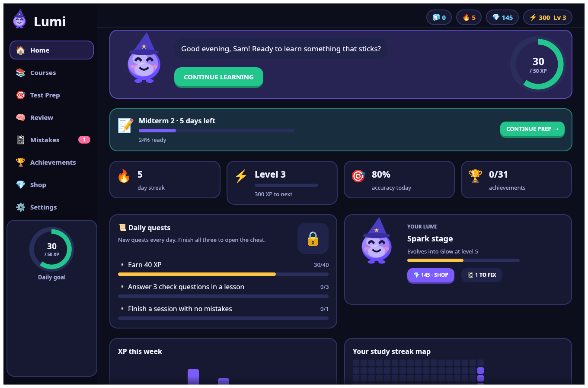
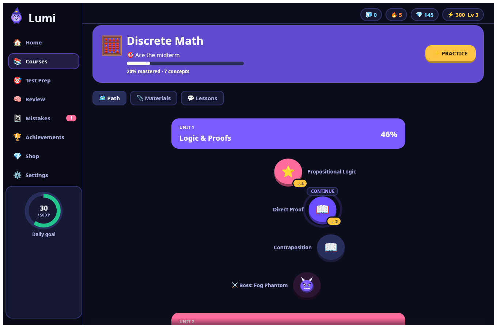
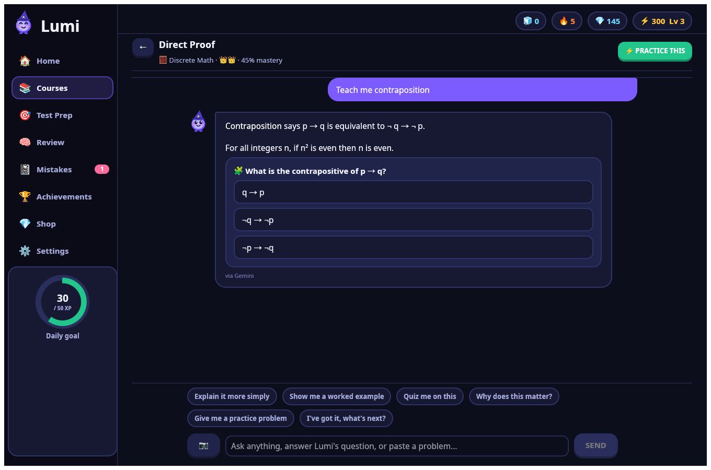
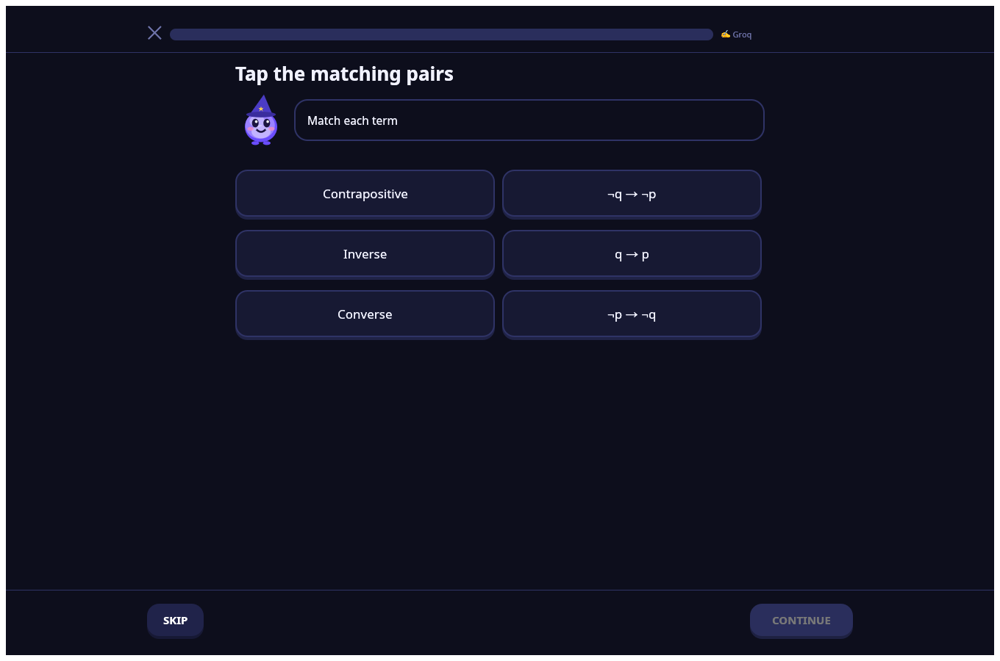

# Lumi ✨

**A personal AI tutor that turns your textbooks, notes and old quizzes into lessons, Duolingo-style quizzes
and test prep.** Lumi is a small native desktop app written in Rust. It isn't a web app, and it runs
smoothly on old and slow computers.

You can use Lumi for **free** with free AI keys (Gemini, Groq, Mistral, OpenRouter), or with a paid
Claude key.



| Learning path | Lesson with Lumi | Quiz |
|---|---|---|
|  |  |  |

## Features

- **Bring your own material:** PDFs (including 1000+ page textbooks), Word files, images, text and notes.
  Lumi indexes them on your computer and sends the AI only the pages that matter.
- **Learning path:** Lumi builds units and concepts from your material. You see crowns for mastery and
  fight a boss at the end of each unit.
- **Lessons:** chat with Lumi, which explains things step by step, quotes your textbook's pages and
  checks your understanding with quick questions. You can also paste or drop in photos of problems.
- **Quizzes:** multiple choice, true/false, fill in the blank, matching, ordering steps and written
  answers (graded by the AI). Questions you miss come back later in the session.
- **Test prep:** add the test date and your material. Lumi finds what's covered, runs a diagnostic, then
  makes a daily plan with lessons, practice and mock exams, and tracks your readiness.
- **Built on learning research:** retrieval practice, spaced review (Leitner boxes), successive
  relearning and a mistake notebook.
- **Motivation:** XP and levels, streaks with freezes, daily quests and a chest, achievements, Lumi
  evolving as you level up, and a gem shop with hats, accessories, confetti styles, themes, Double XP and
  mystery boxes.
- **Desktop reminders** (optional) so you keep your streak.

## Install

### Kubuntu / Ubuntu / Debian (22.04 or newer)

Download the latest `.deb` from the [Releases page](../../releases) and open it (Discover installs it),
or install it from a terminal:

```sh
sudo apt install ./lumi_*_amd64.deb
```

**Without sudo:** download `lumi-…-linux-x86_64.tar.gz`, then:

```sh
tar xzf lumi-*-linux-x86_64.tar.gz
cd lumi-*-linux-x86_64
./install.sh            # puts Lumi in your app menu (./install.sh uninstall removes it)
```

Optional extras: `sudo apt install libnotify-bin fonts-noto-color-emoji` installs notifications for
reminders and color emoji. Both are usually already present on Kubuntu.

### Other Linux distributions

The `.tar.gz` works on most distributions from 2022 or later (glibc 2.35+). If it doesn't, build from
source (below).

### Windows

Download `lumi-…-windows-x86_64.zip`, unzip it, and run `lumi.exe`. Windows may warn you because the
app isn't signed: choose *More info → Run anyway*.

### macOS (Apple Silicon)

Download `lumi-…-macos-arm64.tar.gz`, extract it, and run `lumi`. The first time, right-click it and
choose *Open*, because the app isn't signed.

### Build from source

You need [Rust](https://rustup.rs). On Ubuntu/Kubuntu, first install:

```sh
sudo apt install build-essential pkg-config libasound2-dev libxkbcommon-dev libwayland-dev libx11-dev libgl1-mesa-dev
```

Then build and install:

```sh
git clone https://github.com/Coolcodeingadslfkj/lumi.git
cd lumi
./install.sh            # builds a release and adds Lumi to your app menu
# or simply: cargo run --release
```

## Setting up AI (free)

Open **Settings** in Lumi and paste your own keys. You need at least one; the more you add, the more you
can do each day for free, because Lumi spreads the work across them.

| Provider | Get a free key | Lumi uses it for |
|---|---|---|
| Google Gemini | [aistudio.google.com/apikey](https://aistudio.google.com/apikey) | reading textbooks, teaching, exams (best free choice; reads PDFs directly) |
| Groq | [console.groq.com/keys](https://console.groq.com/keys) | quizzes, practice variants, quick explanations (very fast) |
| Mistral | [console.mistral.ai/api-keys](https://console.mistral.ai/api-keys) | grading written answers, backup teacher |
| OpenRouter | [openrouter.ai/keys](https://openrouter.ai/keys) | backup for everything (free models) |

If a provider hits its free limit, Lumi switches to the next one and tries the first again later.
Settings shows which provider handles each job.

**Claude (paid, optional):** switch to *Claude* mode in Settings and paste an
[Anthropic API key](https://console.anthropic.com/settings/keys). A Claude.ai Pro subscription doesn't
include API access; API use is billed separately.

You can also set keys with environment variables instead: `GEMINI_API_KEY`, `GROQ_API_KEY`,
`MISTRAL_API_KEY`, `OPENROUTER_API_KEY`, `ANTHROPIC_API_KEY`.

## Privacy

- Your keys, courses, files and progress stay on your computer, in one folder:
  - Linux: `~/.local/share/lumi/`
  - Windows: `%APPDATA%\Lumi\`
  - macOS: `~/Library/Application Support/Lumi/`

  Set `LUMI_DATA_DIR` to use another folder. On Linux and macOS, the database is readable only by you.
- Lumi has no accounts, servers, analytics or telemetry. It only connects to the AI providers you add
  keys for, and it sends them the parts of your material that a lesson or quiz needs.
- Free AI tiers may use what you send them to improve their models. Check each provider's terms before
  uploading anything sensitive.

## Updating

Install the new release over the old one (the same way you installed it). Your data folder is separate
from the app, so courses, gems and purchases carry over, and Lumi upgrades its database automatically.

## Troubleshooting

- **The window doesn't open (old or virtual machines without an OpenGL driver):** run
  `LIBGL_ALWAYS_SOFTWARE=1 lumi`.
- **The file picker doesn't open on Linux:** install `xdg-desktop-portal` plus the portal for your
  desktop (`xdg-desktop-portal-kde` on Kubuntu, `-gnome` on Ubuntu). You can also drag files onto the
  window instead.
- **Emoji show as boxes:** install `fonts-noto-color-emoji`, or turn off color emoji in Settings.

## Contributing

- **Add hats, accessories, celebrations or themes to the shop:** see [docs/ADDING_SHOP_ITEMS.md](docs/ADDING_SHOP_ITEMS.md).
  It's a single JSON file, with no Rust needed.
- **Run the tests:** `cargo test --release`. The `screens` test renders every screen to
  `target/screens/` so you can review layout changes.
- **Code map:**

  | Path | Contents |
  |---|---|
  | `src/llm.rs` | providers and routing |
  | `src/ai.rs` | prompts |
  | `src/materials.rs` | PDF indexing and search |
  | `src/game.rs` | XP, quests and shop logic |
  | `src/testprep.rs` | test prep |
  | `src/ui/` | screens |
- **Release:** bump `version` in `Cargo.toml`, then `git tag vX.Y.Z && git push origin vX.Y.Z`. GitHub
  Actions builds the downloads and publishes the release.

## License

The code is under the [MIT license](LICENSE). The bundled Noto fonts are under the
[SIL Open Font License 1.1](assets/fonts/OFL.txt).
